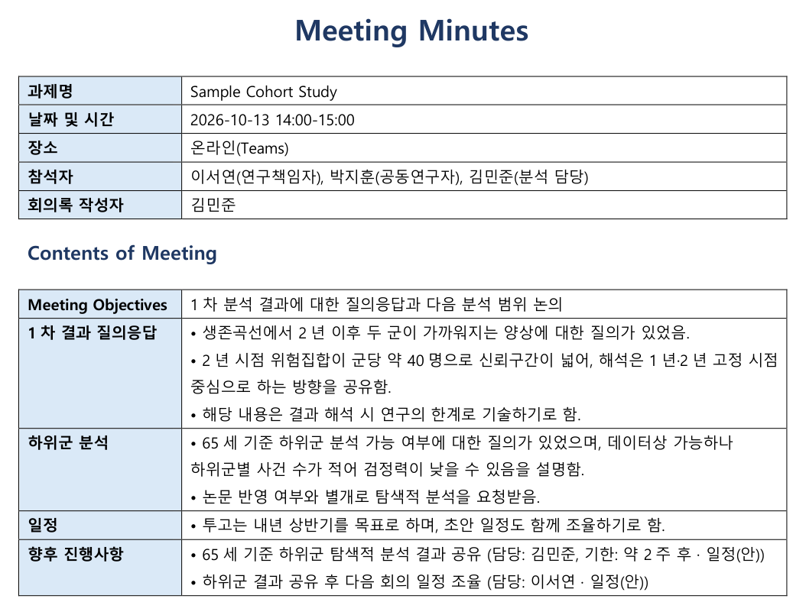

# meeting-minutes-docx

회의 녹음 전사문을 **서식이 갖춰진 Word 회의록**으로 만드는 도구입니다.
AI(Claude)가 전사문을 정해진 규칙에 따라 정리하고, `minutes.py`가 그 내용을 Word 양식에 채워 저장합니다.

```
전사문(.txt) ──[ Claude + SKILL.md 규칙 ]──▶ minutes.json ──[ minutes.py ]──▶ 20261013_과제명_연구자미팅_회의록.docx
```



<sub>가상의 회의 전사문([`examples/transcript.txt`](examples/transcript.txt))으로 만든 결과</sub>

## 왜 만들었나
회의록을 매번 손으로 정리하면 시간이 오래 걸리고, AI에 그냥 맡기면 질문이 "요청"으로, 의견 교환이 "결정"으로 부풀려지기 쉽습니다.
그래서 **정리 규칙**(SKILL.md)과 **서식**(minutes.py)을 분리해, 내용은 전사문에 근거하고 모양은 항상 같게 나오도록 했습니다.

## 정리 규칙 (SKILL.md)
- 전사문에 없는 정보는 지어 채우지 않는다.
- 질의응답·의견 교환·추가 검토 요청·확정 결정을 구분한다.
- 담당자·기한이 회의에서 확정되지 않았으면 "일정(안)"으로 표시한다.
- 중립적 공식 문체, A4 1페이지 내외.

## 서식 (minutes.py)
- 기본 정보 표(과제명·날짜·장소·참석자·작성자)와 내용 표(목적·안건별 요점·향후 진행사항)
- 맑은 고딕, 표 안 9.5pt, 왼쪽 항목 칸 하늘색, 긴 행은 페이지를 넘어 이어짐
- 파일명 `YYYYMMDD_과제명_회의유형_회의록.docx` 자동 생성(Windows 금지 문자 치환)
- 필수 항목 누락, 날짜 형식 오류는 저장 전에 막음

## 예시
[`examples/transcript.txt`](examples/transcript.txt)(가상의 회의) → [`examples/minutes.json`](examples/minutes.json) → [`examples/20261013_Sample_Cohort_Study_연구자미팅_회의록.docx`](examples/)
예시의 사람·기관·수치는 모두 지어낸 것입니다.

## 구성
- Claude Code 스킬(`SKILL.md`): 위 정리 규칙과 JSON 형식
- `minutes.py`: python-docx로 양식을 그리고 채우는 스크립트
- 테스트: 파일명 규칙, "일정(안)" 표시, 필수 항목 검증, 서식(글꼴·크기·칸 색) 확인

## 코드
이 저장소는 **소개용**입니다. 소스 코드는 비공개로 관리합니다.
채용·협업 등으로 코드를 보고 싶으시면 [프로필](https://github.com/pkjphj2)의 연락처로 알려 주세요.

## License
All rights reserved. 열람만 허용하며, 허락 없이 복제·수정·배포·사용할 수 없습니다. 자세한 내용은 [LICENSE](LICENSE).
